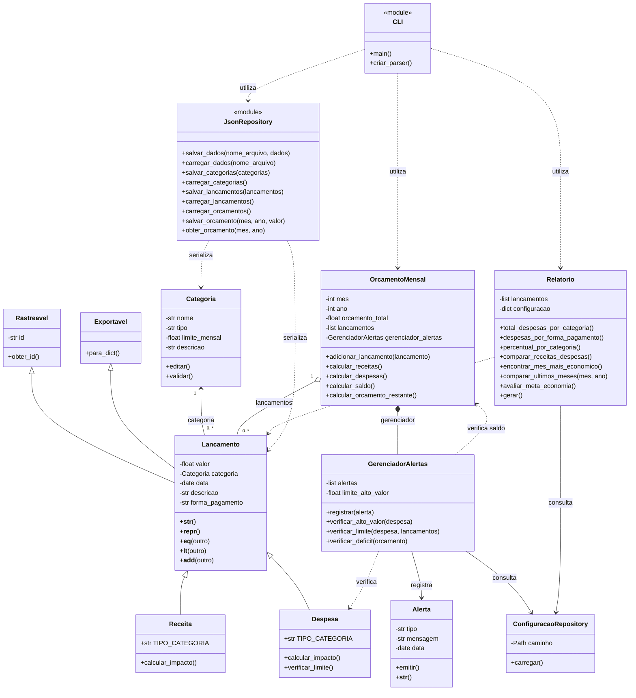

# Sistema de Controle de Despesas Pessoais

Projeto desenvolvido em Python para a disciplina de Programação Orientada a Objetos do curso de Engenharia de Software. A aplicação funciona por linha de comando (CLI) e permite registrar receitas e despesas, organizar movimentações por categorias, definir orçamentos mensais, consultar saldos, emitir alertas e gerar relatórios financeiros. Os dados são persistidos localmente em arquivos JSON.

## 1. Objetivo

Oferecer uma ferramenta simples para acompanhar a movimentação financeira pessoal e apoiar a análise dos gastos. O projeto também demonstra conceitos de Programação Orientada a Objetos, como encapsulamento, herança, herança múltipla, associação entre objetos, polimorfismo, métodos especiais e separação de responsabilidades.

## 2. Funcionalidades

- Cadastro de categorias dos tipos `RECEITA` e `DESPESA`.
- Registro de receitas e despesas vinculadas a categorias compatíveis.
- Registro de data, descrição, valor e forma de pagamento.
- Definição de orçamento previsto por mês.
- Consulta de receitas, despesas, saldo e orçamento restante.
- Alertas para despesas de alto valor, estouro do limite de uma categoria e saldo mensal negativo.
- Relatórios de despesas por categoria e por forma de pagamento.
- Cálculo do percentual de cada categoria em relação ao total de despesas.
- Comparação entre receitas, despesas e saldo.
- Identificação do mês mais econômico no histórico.
- Comparação financeira dos últimos meses, conforme configuração.
- Avaliação da meta percentual de economia.

## 3. Tecnologias e requisitos

- Python 3.10 ou superior.
- `pytest` para execução dos testes automatizados.
- Biblioteca padrão do Python (`argparse`, `json`, `datetime`, `pathlib`, entre outras).
- Persistência em arquivos JSON.

Não há dependências externas de execução além do próprio Python. O `pytest` é utilizado para os testes.

## 4. Estrutura do projeto

```text
Projeto-POO-Sistema-de-Controle-de-Despesas-Pessoais/
├── main.py
├── settings.json
├── requirements.txt
├── README.md
├── docs/
│   └── diagrama_uml.md
└── src/
    ├── data/
    │   ├── categorias.json
    │   ├── lancamentos.json
    │   └── orcamentos.json
    ├── entities/
    │   ├── transactions/
    │   │   ├── lancamento.py
    │   │   ├── receita.py
    │   │   ├── despesa.py
    │   │   ├── rastreavel.py
    │   │   └── exportavel.py
    │   ├── finance/
    │   │   ├── categoria.py
    │   │   └── orcamento_mensal.py
    │   ├── alerts/
    │   │   ├── alerta.py
    │   │   └── gerenciador_alertas.py
    │   └── reports/
    │       └── relatorio.py
    ├── persistence/
    │   ├── json_repository.py
    │   └── configuracao_repository.py
    └── tests/
        ├── test_alertas.py
        ├── test_categoria.py
        ├── test_cli.py
        ├── test_json_respository.py
        ├── test_lancamento.py
        ├── test_metodos_especiais.py
        ├── test_orcamento_mensal.py
        ├── test_rastreavel.py
        ├── test_receita_despesa.py
        ├── test_regras_negocio.py
        └── test_relatorio.py
```

### Organização dos módulos

- `entities/transactions/`: classes de lançamentos, identificação e exportação.
- `entities/finance/`: categorias e orçamento mensal.
- `entities/alerts/`: representação e gerenciamento de alertas.
- `entities/reports/`: geração de relatórios financeiros.
- `persistence/`: leitura e gravação dos dados JSON e das configurações.
- `data/`: arquivos JSON gerados e utilizados pela aplicação.
- `tests/`: testes automatizados das entidades, regras, persistência, relatórios e interface.
- `docs/`: documentação complementar, incluindo o diagrama UML.
- `main.py`: ponto de entrada e definição dos comandos da CLI.
- `settings.json`: parâmetros configuráveis do sistema.

## 5. Explicação das classes

### 5.1 Lançamentos financeiros

| Classe | Responsabilidade |
|---|---|
| `Lancamento` | Classe-base de uma movimentação. Armazena valor, categoria, data, descrição e forma de pagamento. Implementa validações e métodos especiais. |
| `Receita` | Especialização de `Lancamento` para entradas financeiras. Seu impacto no saldo é positivo. |
| `Despesa` | Especialização de `Lancamento` para saídas financeiras. Seu impacto no saldo é negativo e pode verificar o limite da categoria. |
| `Rastreavel` | Fornece um identificador único (UUID) aos objetos. Permite preservar o mesmo ID ao carregar dados persistidos. |
| `Exportavel` | Fornece `para_dict()`, convertendo os atributos do objeto em um dicionário para serialização. |

`Lancamento` herda de `Rastreavel` e `Exportavel`, caracterizando herança múltipla. `Receita` e `Despesa` herdam de `Lancamento`.

### 5.2 Controle financeiro

| Classe | Responsabilidade |
|---|---|
| `Categoria` | Representa uma categoria de receita ou despesa. Valida nome, tipo, limite mensal e descrição. |
| `OrcamentoMensal` | Agrupa os lançamentos de um mês/ano, calcula receitas, despesas, saldo e orçamento restante, além de acionar as verificações de alerta. |

Cada `Lancamento` mantém uma referência a uma `Categoria`. Um `OrcamentoMensal` mantém uma coleção de lançamentos pertencentes ao mês e ano correspondentes.

### 5.3 Alertas

| Classe | Responsabilidade |
|---|---|
| `Alerta` | Representa uma notificação, contendo tipo, mensagem e data, e disponibiliza sua representação textual. |
| `GerenciadorAlertas` | Registra alertas e verifica despesas acima do limite de alto valor, estouro do limite mensal da categoria e saldo negativo. Lê o limite de alto valor das configurações. |

### 5.4 Relatórios

| Classe | Responsabilidade |
|---|---|
| `Relatorio` | Recebe uma coleção de lançamentos e calcula totais por categoria, totais por forma de pagamento, percentuais, comparação entre receitas e despesas, mês mais econômico, comparação dos últimos meses e avaliação da meta de economia. |

### 5.5 Persistência

Os módulos de persistência não são classes de domínio:

- `json_repository.py`: disponibiliza funções para salvar e carregar categorias, lançamentos e orçamentos. Os lançamentos são reconstruídos como objetos `Receita` ou `Despesa`, preservando seus IDs.
- `ConfiguracaoRepository`: carrega os parâmetros de `settings.json`.

## 6. Decisões de design

1. **Separação por responsabilidade:** entidades financeiras, alertas, relatórios e persistência ficam em módulos distintos para reduzir acoplamento e facilitar manutenção.
2. **Herança:** `Receita` e `Despesa` especializam a classe comum `Lancamento`, reaproveitando atributos, validações e comportamentos.
3. **Herança múltipla:** `Lancamento` herda de `Rastreavel` e `Exportavel`, separando a responsabilidade de identificação da capacidade de conversão para dicionário.
4. **Encapsulamento:** propriedades e setters validam os dados atribuídos, como valor positivo, categoria compatível, data válida e forma de pagamento permitida.
5. **Composição/associação entre objetos:** lançamentos referenciam categorias; orçamentos mantêm os lançamentos do período; o orçamento utiliza um gerenciador de alertas.
6. **Persistência desacoplada:** os dados são armazenados em JSON por funções de repositório, sem misturar a lógica de gravação com as regras das entidades.
7. **Configuração externa:** valores ajustáveis ficam em `settings.json`, evitando fixar parâmetros como limite de alto valor e quantidade de meses comparados diretamente na lógica.
8. **Interface CLI:** `argparse` organiza os comandos e permite utilizar o sistema pelo terminal sem interface gráfica.
9. **Testes automatizados:** `pytest` verifica as regras das classes, cálculos, alertas, serialização, relatórios e comandos.

### Métodos especiais implementados

Na classe `Lancamento`:

- `__str__`: apresentação amigável do lançamento.
- `__repr__`: representação detalhada para depuração.
- `__eq__`: compara lançamentos pela data e descrição.
- `__lt__`: permite ordenar lançamentos pela data.
- `__add__`: soma valores apenas quando os lançamentos são do mesmo tipo concreto.

## 7. Configurações

O arquivo `settings.json` contém:

```json
{
    "limite_alerta_alto_valor": 500,
    "meses_comparacao": 3,
    "meta_economia_percentual": 20
}
```

- `limite_alerta_alto_valor`: valor a partir do qual uma despesa gera alerta quando o ultrapassa.
- `meses_comparacao`: quantidade de meses considerados no relatório comparativo.
- `meta_economia_percentual`: percentual mínimo de economia usado na avaliação da meta.

O orçamento previsto de cada mês é armazenado separadamente em `src/data/orcamentos.json`.

## 8. Instalação e execução

### Pré-requisitos

Tenha Python instalado e disponível no terminal. Recomenda-se criar um ambiente virtual.

### Windows (PowerShell)

```powershell
python -m venv .venv
.\.venv\Scripts\Activate.ps1
python -m pip install -r requirements.txt
```

Caso o PowerShell bloqueie a ativação do ambiente, também é possível executar os comandos usando `python` sem ativá-lo, desde que o Python e o `pytest` estejam instalados.

### Linux ou macOS

```bash
python3 -m venv .venv
source .venv/bin/activate
python -m pip install -r requirements.txt
```

### Executar a aplicação

Na pasta raiz do projeto:

```bash
python main.py --help
```

## 9. Comandos da CLI

Os comandos abaixo são executados na pasta raiz do projeto.

### Cadastrar categorias

```bash
python main.py categoria adicionar --nome Salário --tipo RECEITA
python main.py categoria adicionar --nome Alimentação --tipo DESPESA --limite 800 --descricao "Gastos com alimentação"
```

O limite mensal é opcional e aplicável a categorias de despesa.

### Registrar receita

A categoria do tipo `RECEITA` precisa existir antes do lançamento.

```bash
python main.py receita adicionar --valor 2500 --categoria Salário --data 2026-11-01 --descricao "Salário mensal" --pagamento PIX
```

### Registrar despesa

A categoria do tipo `DESPESA` precisa existir antes do lançamento.

```bash
python main.py despesa adicionar --valor 300 --categoria Alimentação --data 2026-11-01 --descricao "Compras do mês" --pagamento PIX
```

Formas de pagamento aceitas: `DINHEIRO`, `DEBITO`, `CREDITO` e `PIX`. Se `--data` for omitido, o sistema utiliza a data atual.

### Definir orçamento mensal

```bash
python main.py orcamento definir --mes 11 --ano 2026 --valor 2000
```

### Consultar saldo e orçamento

```bash
python main.py saldo --mes 11 --ano 2026
```

O saldo é calculado por receitas menos despesas. O orçamento restante é calculado pelo orçamento previsto menos as despesas realizadas; são indicadores diferentes.

### Gerar relatórios

```bash
python main.py relatorio --mes 11 --ano 2026
```

O relatório exibe despesas por categoria, despesas por forma de pagamento, percentual por categoria, comparação de receitas/despesas/saldo, mês mais econômico do histórico, comparação dos últimos meses e avaliação da meta de economia.

### Visualizar alertas

```bash
python main.py alertas
```

## 10. Persistência dos dados

Os arquivos ficam em `src/data/`:

- `categorias.json`: categorias cadastradas.
- `lancamentos.json`: receitas e despesas, incluindo seus identificadores.
- `orcamentos.json`: orçamento previsto de cada mês, identificado no formato `AAAA-MM`.

Esses arquivos são criados ou atualizados conforme o uso do sistema. Para começar com uma base vazia, faça uma cópia de segurança e limpe o conteúdo dos arquivos JSON, mantendo-os com estruturas compatíveis (`[]` para categorias e lançamentos; `{}` para orçamentos).

## 11. Testes

Execute na raiz do projeto:

```bash
pytest
```

Os testes cobrem categorias, lançamentos, herança e métodos especiais, identificação, regras de negócio, orçamento mensal, alertas, persistência JSON, relatórios e CLI.

## 12. Diagrama UML

O diagrama completo está disponível em [`docs/diagrama_uml.md`](docs/diagrama_uml.md) e também é reproduzido abaixo.



## 13. Observações sobre o escopo

A aplicação implementa a interface CLI e persistência JSON. Não possui interface gráfica ou banco de dados SQL. As operações de gerenciamento de categorias disponíveis na CLI nesta versão são de cadastro; edição e exclusão não estão expostas como comandos. O orçamento previsto é tratado como teto de despesas para o cálculo do orçamento restante, enquanto o saldo disponível é calculado separadamente pelas receitas e despesas efetivamente registradas.

## 14. Entrega

Para a entrega, inclua o código-fonte, os testes, este README, o diagrama UML e os arquivos de configuração. Recomenda-se executar `pytest` antes de enviar a versão final.
